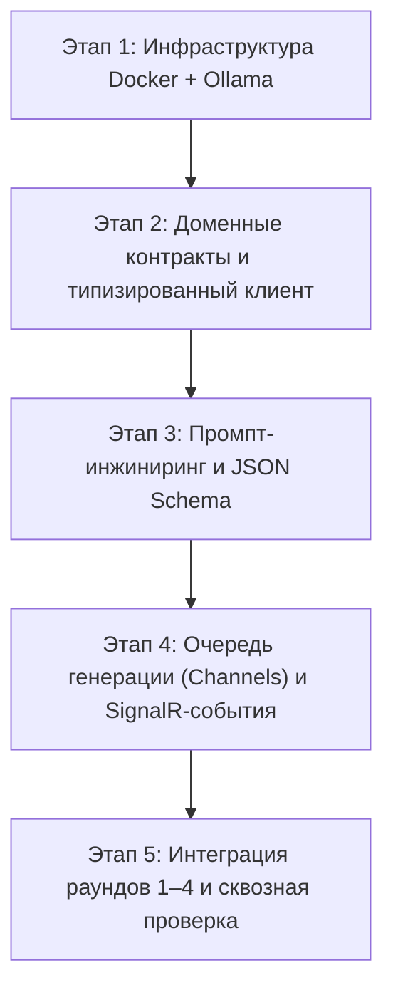

# План внедрения и Roadmap интеграции локальной LLM через Ollama

Статус: **актуальная спецификация интеграции ИИ**. Заменяет первоначальный план использования облачного API на локальный инференс через **Ollama** в `docker-compose`.

Связанные документы:
- [Целевой контракт API v2](backend.md)
- [План интеграции фронта и бэка](../../docs/integration.md)
- [Общее описание игры](../../docs/overall.md)

---

## 1. Выбор модели под целевое железо (8 ГБ VRAM / Mac 16 ГБ)

### Ограничения среды
- **Бюджет видеопамяти**: 8 ГБ VRAM (или 16 ГБ единой памяти Apple Silicon).
- **Важный нюанс**: если на той же машине открыт браузер с 3D-сценой (`Three.js` / `WebGL`), он потребляет ~1.0–1.5 ГБ видеопамяти. Значит, под модель + KV-кэш контекста остаётся **~6.0–6.5 ГБ VRAM**.
- Если модель хотя бы частично выгружается в оперативную память (CPU offload), скорость генерации падает в 5–7 раз (с 60 токенов/с до 8–10 токенов/с), что критично при генерации реплик 10 NPC и их реакций на лету.

### Рекомендуемые модели

| Приоритет | Модель в Ollama | Квантизация и вес | Потребление VRAM (с контекстом 4K) | Скорость (RTX 3060/4060) | Почему подходит |
| --- | --- | --- | --- | --- | --- |
| **1. Основной выбор (Рекомендуется)** | `qwen2.5:7b-instruct` *(или `qwen3:8b`)* | `Q4_K_M` (~4.7 ГБ) | ~5.6–6.0 ГБ | 55–75 ток/с (~1 сек на реплику) | Лучший русский язык и молодёжный сленг в классе до 8B, идеально держит строгую JSON-схему (`format`), не путается в ролях «Друг» vs «Актёр». |
| **2. Если 3D-клиент запущен на том же ПК** | `gemma3:4b` *(или `qwen2.5:3b-instruct`)* | `Q4_K_M` / `Q8_0` (~2.5–3.2 ГБ) | ~3.5–4.2 ГБ | 90–130 ток/с (~0.5 сек на реплику) | Оставляет запас VRAM для браузера с WebGL, мгновенный отклик, хорошее качество коротких реплик и реакций. |
| **3. Альтернатива для ролевого сленга** | `saiga_llama3` / `llama3.1:8b-instruct` | `Q4_K_M` (~4.9 ГБ) | ~6.0–6.3 ГБ | 50–65 ток/с | Живой разговорный стиль (особенно у дообученных на русском версий), но чуть выше риск выхода за лимит VRAM при одновременном запуске игры. |

**Итоговая рекомендация:**
- В качестве дефолтной модели в `.env` использовать **`qwen2.5:7b-instruct`** (при запуске сервера отдельно или на Mac 16 ГБ).
- Для локальной разработки на одной машине (где одновременно открыты IDE, Docker, PostgreSQL и два окна браузера с 3D) иметь возможность переключить переменную `OLLAMA__MODEL=gemma3:4b` или `qwen2.5:3b-instruct` без изменения кода.

---

## 2. Архитектура генерации «всё на лету» (Раунды 1–4 + реакции 9 NPC)

### Проблема наивного подхода
В игре 10 NPC. Если на каждую реплику говорящего делать **1 запрос на речь + 9 отдельных запросов на `NpcReaction`** остальных ботов, получится **10 последовательных вызовов LLM на одно высказывание** и **100 вызовов за один раунд**. Даже при 1.2 сек на запрос один раунд растянется на 2+ минуты ожидания.

### Решение: Паттерн «1 + 1» (Двухшаговый конвейер с батчингом реакций)

На каждое выступление NPC (в раундах 1–3 или при ответе на вопрос в раунде 4) бэкенд делает **2 быстрых запроса вместо 10**:

1. **Шаг 1 — Реплика говорящего NPC (`SpeakerTurn`)**:
   - Формируется системный промпт конкретного NPC (его личность, роль `Friend` или `Actor`, секретный `SharedLore` или легенда, краткая история последних реплик).
   - Вызывается Ollama `/api/chat` (`stream: false`, `format: schema`).
   - Модель возвращает `{"text": "...", "emotion": "smirk"}` (~40–60 токенов, ~1 сек).
   - Сервер **немедленно** сохраняет реплику в БД и рассылает всем игрокам `NpcSay` через SignalR. Игроки уже читают текст!

2. **Шаг 2 — Пакетная генерация реакций 9 слушателей (`EnsembleReactions`)**:
   - Сразу после отправки `NpcSay` (пока игроки читают реплику) сервер отправляет **один батч-запрос** в Ollama.
   - На вход подаётся только что сказанная реплика и краткая матрица остальных 9 NPC (кто настоящий друг говорящего, кто актёр и под кого косит).
   - Модель одним JSON-массивом возвращает короткие реакции и эмоции для остальных участников:
     ```json
     {
       "reactions": [
         { "npcNumber": 2, "reaction": "фейспалм", "emotion": "facepalm" },
         { "npcNumber": 5, "reaction": "активно кивает", "emotion": "smile" }
       ]
     }
     ```
   - Сервер веерно рассылает события `NpcReaction {npc, reaction, emotion}` (скрытые причины `reason` остаются только в серверном контексте согласно контракту v2).

3. **Шаг 3 — Фоновый префетч в раундах 1–3 (`Channel<GenerationJob>`)**:
   - В раундах 1–3 реплики всех 10 NPC идут по очереди. Пока на экране висит реплика NPC №1 (пауза на чтение 5–7 секунд), `BackgroundService` через `System.Threading.Channels` уже генерирует в Ollama реплику и реакции для NPC №2. Задержки между ботами для игроков сводятся к нулю.

---

## 3. Архитектура кода в `backend/` (Clean Code & OOP)

В соответствии с правилами проекта (`sealed`-классы, primary constructors, никаких `*Manager`/`*Helper`/`*Utils`, один публичный тип на файл, регистрация через `services.AddOllama(config)`, XML-комментарии):

### Модуль `Infrastructure.Ollama` и доменные абстракции

1. **Абстракции (в слое Domain / Application)**:
   - `INpcDialogueModel` — интерфейс генерации реплики одного NPC по его контексту (`GenerateReplyAsync(NpcDialoguePrompt prompt, CancellationToken ct)`).
   - `INpcReactionModel` — интерфейс пакетной генерации реакций остальных 9 NPC на произнесённую реплику (`GenerateReactionsAsync(NpcReactionBatchPrompt prompt, CancellationToken ct)`).
   - `IGameGenerationQueue` — абстракция асинхронной очереди задач генерации на базе `Channel<T>`.

2. **Конфигурация (`OllamaOptions`)**:
   - Секция настроек, привязанная к переменным окружения:
     - `OLLAMA__BASEURL` (в Docker: `http://ollama:11434`)
     - `OLLAMA__MODEL` (например, `qwen2.5:7b-instruct`)
     - `OLLAMA__TIMEOUTSECONDS` (например, `30`)
     - `OLLAMA__MAXCONTEXTTOKENS` (`4096`)
     - `OLLAMA__TEMPERATURE` (`0.75`)
     - `OLLAMA__KEEPALIVE` (`-1` — держать модель в VRAM постоянно)

3. **Реализация клиента и пайплайна**:
   - `OllamaHttpClient` (`sealed`) — типизированный клиент поверх `HttpClient` (`IHttpClientFactory`), инкапсулирующий вызов `POST /api/chat` с поддержкой JSON Schema (`format`) и `options` (`num_ctx`, `temperature`, `num_predict`).
   - `OllamaNpcDialogueModel` (`sealed`) — реализация `INpcDialogueModel`, валидирующая ответ и нормализующая код эмоции (при неизвестной эмоции — fallback на `neutral`).
   - `OllamaNpcReactionModel` (`sealed`) — реализация `INpcReactionModel` для батч-генерации реакций остальных NPC.
   - `NpcPromptComposer` (`sealed`) — сборщик системного и пользовательского промпта из роли NPC, `SharedLore` и усечённой истории диалога (чтобы не превышать окно `num_ctx`).
   - `OllamaWarmupHostedService` (`BackgroundService`) — при старте бэкенда проверяет доступность Ollama, наличие нужной модели (`GET /api/tags`, при отсутствии — логирует или вызывает `/api/pull`) и делает холостой прогревочный запрос для загрузки весов в VRAM до старта первой игры.
   - `DialogueGenerationWorker` (`BackgroundService`) — читает задачи из `Channel<DialogueTask>`, последовательно вызывает Ollama (чтобы не перегружать одну GPU параллельными запросами), отправляет `NpcThinking`, `NpcSay`, `NpcReaction` или `QuestionFailed` (`LLM_TIMEOUT` / `LLM_ERROR`).

4. **Регистрация в DI**:
   - Метод расширения `ServiceCollectionExtensions.AddOllama(this IServiceCollection services, IConfiguration configuration)`.

---

## 4. Конфигурация Docker Compose

В `docker-compose.yml` добавляются 3 сервиса в единой сети:
- `postgres`: PostgreSQL 16 с volume для данных.
- `ollama`: официальный образ `ollama/ollama:latest` с пробросом GPU (`deploy.resources.reservations.devices` с драйвером `nvidia` для Windows/Linux; для macOS Apple Silicon Ollama запускается на хосте и доступна из контейнера бэкенда через `http://host.docker.internal:11434`, так как Docker Desktop на Mac не пробрасывает Metal GPU внутрь Linux-контейнера) и постоянным volume `ollama_data:/root/.ollama`, чтобы не качать 5 ГБ модель при каждом перезапуске.
- `backend`: ASP.NET Core сервис, зависящий от `postgres` и `ollama`.

---

## 5. Roadmap интеграции



### Этап 1. Инфраструктура и окружение (`docker-compose` + `.env`)
- [ ] Создать `docker-compose.yml` с сервисами `postgres`, `ollama`, `backend` и постоянными томами (`postgres_data`, `ollama_data`).
- [ ] Добавить `.env.example` с переменными `OLLAMA__BASEURL`, `OLLAMA__MODEL`, `OLLAMA__TIMEOUTSECONDS`, `OLLAMA__KEEPALIVE` и строкой подключения к БД.
- [ ] Настроить автоматический прогрев / проверку модели при старте (`OllamaWarmupHostedService`).
- **Критерий готовности**: контейнеры поднимаются, модель `qwen2.5:7b-instruct` загружается в VRAM (`ollama ps` показывает `100% GPU`).

### Этап 2. Абстракции и HTTP-клиент Ollama (`AddOllama`)
- [ ] Описать неизменяемые `record`-типы запросов/ответов (`NpcDialoguePrompt`, `NpcReply`, `NpcReactionBatchPrompt`, `NpcReactionItem`) и `OllamaOptions`.
- [ ] Реализовать `INpcDialogueModel` и `INpcReactionModel`.
- [ ] Реализовать `OllamaHttpClient` через `IHttpClientFactory` с поддержкой строгой JSON-схемы в поле `format`, параметров `keep_alive: -1`, `num_ctx: 4096` и пробросом `CancellationToken`.
- [ ] Оформить расширение `services.AddOllama(config)`.
- **Критерий готовности**: бэкенд отправляет тестовый запрос в Ollama и десериализует типизированный `NpcReply` без регулярных выражений и костылей парсинга.

### Этап 3. Сборщик промптов и батчинг реакций (`NpcPromptComposer`)
- [ ] Реализовать шаблоны промптов для двух ролей: `TrueFriend` (с общей базой `SharedLore`: точка знакомства, общий косяк, долг/мем) и `Actor` (с легендой и целевым NPC).
- [ ] Настроить специфику промптов под каждую фазу игры:
  - Раунд 1 (`presentation`): визитка и «красный флаг» в дружбе;
  - Раунд 2 (`gossip`): история одного общего косяка;
  - Раунд 3 (`blindspots`): два абсурдных факта о друге;
  - Раунд 4 (`interrogation`): ответ на прямой вопрос игрока из жюри с учётом последних реплик чата.
- [ ] Реализовать промпт пакетной генерации `NpcReaction` для остальных 9 NPC (паттерн «1 + 1»).
- **Критерий готовности**: реплики друзей синхронизированы по фактам из `SharedLore`, актёры уверенно блефуют, эмоции приходят из белого списка (иначе заменяются на `neutral`).

### Этап 4. Очередь генерации (`System.Threading.Channels`) и интеграция с SignalR
- [ ] Создать `DialogueGenerationWorker` (`BackgroundService`) и потокобезопасную очередь на `System.Threading.Channels`, гарантирующую, что к локальной GPU в один момент времени выполняется ровно один инференс-запрос.
- [ ] Реализовать конвейер для раундов 1–3: фоновая предгенерация следующей реплики, пока игроки читают текущую.
- [ ] Реализовать обработку `AskQuestion` в раунде 4 согласно контракту API v2:
  - валидация лимита → `QuestionOk` → `NpcThinking` → вызов очереди Ollama → `NpcSay` + сохранение в PostgreSQL → фоновый вызов `NpcReaction`;
  - при таймауте или сбое Ollama — возврат попытки игроку (если раунд 4 ещё идёт) и отправка `QuestionFailed` с кодом `LLM_TIMEOUT` или `LLM_ERROR`.
- **Критерий готовности**: в раунде 4 при одновременных вопросах от нескольких судей запросы не роняют Ollama, а аккуратно встают в очередь с индикацией «Думает…».

### Этап 5. Полировка таймингов и приёмочная проверка
- [ ] Подобрать `num_predict` (лимит длины генерации, например 80–120 токенов) и `temperature`, чтобы реплики были живыми, ёмкими и генерировались быстрее 1.5 секунд.
- [ ] Проверить, что секретные поля (`SharedLore`, роль NPC, внутренний `reason` реакции) ни при каких условиях не попадают в `NpcSay`, `NpcReaction`, `ChunkData` или `StateSnapshot` до финала (`GameEnded`).
- [ ] Прогнать полный цикл партии из 5 раундов с двумя браузерами и убедиться в отсутствии фризов и утечек VRAM.
