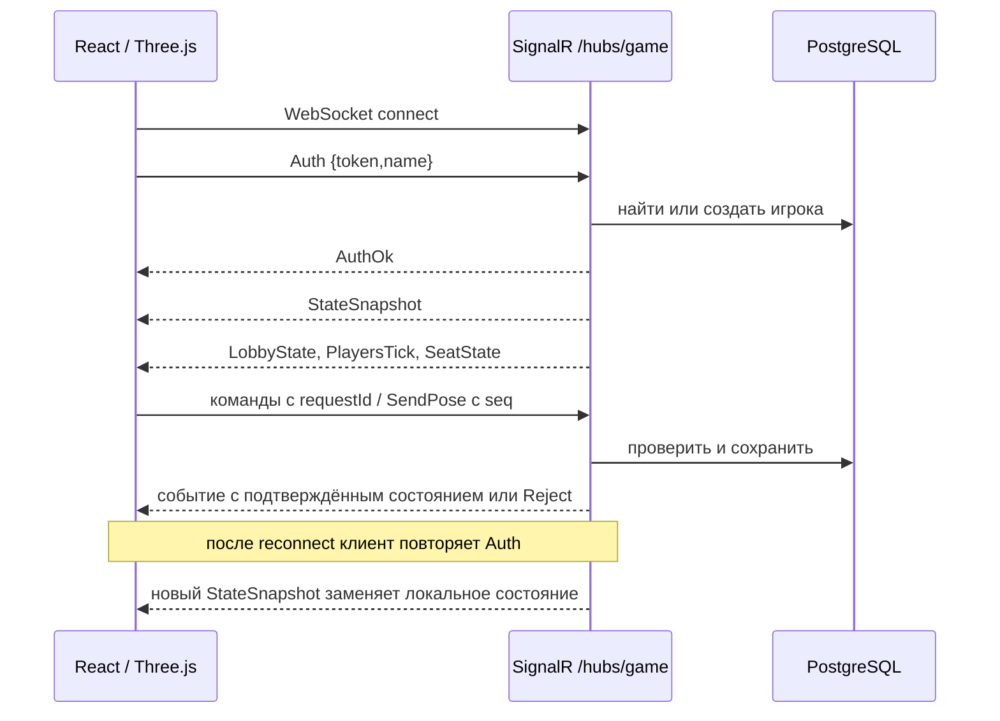

# Схема интеграции фронтенда и API

Фронтенд React/Three.js подключается к ASP.NET Core через SignalR hub `/hubs/game`. В браузере нет мокового клиента и локального сценария: данные игроков, NPC, сцены, раундов, вопросов, доски, чата и результатов приходят с сервера. REST endpoints `/health` и `/health/db` предназначены для диагностики сервисов.

## Запуск и адреса

1. Запустить PostgreSQL и бэкенд по [инструкции](../backend/README.md). Бэкенд требует `DATABASE_URL`, `GAME_TOKENS` и разрешённый origin в `GAME_ORIGINS`.
2. В `frontend/.env` задать `BACKEND_URL=http://127.0.0.1:5000` для Vite proxy, затем выполнить `cd frontend && npm ci && npm run dev`.
3. Браузер открывает `http://localhost:5173`; Vite проксирует `/hubs/game` на бэкенд. Для отдельного origin можно задать `VITE_HUB_ORIGIN` и разрешить его origin в `GAME_ORIGINS`. Токен вводится в форме и передаётся только в `Auth` по WebSocket, без URL и localStorage.

JSON использует `camelCase`. Все даты и дедлайны — Unix milliseconds UTC; координаты в метрах, Y вверх; углы в радианах; NPC имеют серверные `id` и `number` 1–10. Клиент отправляет команды только после пары `AuthOk` → `StateSnapshot`.

## Источники данных по экрану

| Экран/состояние | Данные сервера | Реакция фронта |
| --- | --- | --- |
| Лобби | `LobbyState`, `StateSnapshot.me` | список игроков, ведущий по `leaderId`, доступность старта |
| 3D-студия | `StateSnapshot.scene`, `npcs`, `players`, `seats`; затем `PlayersTick`, `SeatState` | геометрия комнаты, якоря NPC, позиции игроков и свободные кресла |
| Детали NPC | `RequestChunk` → `ChunkData` | одна видимая запись в ограниченном кэше; `ReleaseChunk` при смене цели |
| Раунды и таймер | `RoundStarted`, `RoundEnded`, `GameEnded`; при восстановлении `StateSnapshot.round/phase` | показывает серверный `endsAt`, локально раунд не переключает |
| Доска | `StateSnapshot.board`, `BoardSnapshot`, `BoardReject`, `PairSubmitted` | пара, метки актёров, заметки и выбранная пара только после ответа сервера |
| Вопросы | `StateSnapshot.questions`, `QuestionOk`, `QuestionState`, `QuestionFailed`, `QuestionReject` | остаток, адресаты и ожидание ответа |
| Чат и финал | `StateSnapshot.chat/scoreboard/reveal`, `NpcSay`, `ScoreUpdate`, `GameEnded` | реплики по серверным ID, очки и раскрытие ролей |

`StateSnapshot` полностью заменяет игровые коллекции после входа или восстановления: `{sessionId,me,phase,round,rounds,scene,players,npcs,seats,board,questions,chat,worldSizeBytes,score,scoreboard,reveal}`. `round=null` в лобби; `scoreboard` и `reveal` доступны только после финала. Секретные роли и истории NPC до финала не передаются.

## Команды фронта

| Метод | Тело | Подтверждение / отказ |
| --- | --- | --- |
| `Auth` | `{token,name}` | `AuthOk`, `StateSnapshot` / `AuthErr` |
| `StartGame` | без аргумента, только ведущий | `GameStarted`, `RoundStarted` |
| `SendPose` | `{seq,position:{x,y,z},yaw,pitch}` | `PlayersTick`, `SeatState` / `ActionReject` |
| `SitDown`, `StandUp` | `{requestId,seatId}` / `{requestId}` | `PlayersTick`, `SeatState` / `ActionReject` |
| `RequestChunk`, `ReleaseChunk` | `{reqId,ids}` / `{ids}` | `ChunkData` / `ServerError` |
| `PairNpcs`, `UnpairNpcs` | `{requestId,a,b}` | `BoardSnapshot` / `BoardReject` |
| `MarkLiar`, `UnmarkLiar` | `{requestId,npc}` | `BoardSnapshot` / `BoardReject` |
| `SaveNote` | `{requestId,npc,text}` | `BoardSnapshot` / `BoardReject` |
| `SubmitPair` | `{requestId,round,a,b}` или `{requestId,round,skip:true}` | `BoardSnapshot`, `PairSubmitted` / `BoardReject` |
| `AskQuestion` | `{requestId,targetNpc,text}` | `QuestionOk` → `NpcThinking` → `QuestionState`, `NpcSay`; либо `QuestionReject` / `QuestionFailed` |
| `Ping` | `{t}` | `Pong {t,serverTime}` |

`requestId` связывает ответ с командой и используется сервером для идемпотентности. `SendPose.seq` монотонно растёт, клиент передаёт не чаще 10 раз в секунду. Доска не меняется оптимистично. `SubmitPair` доступен только в фазе `choice` после раундов 2, 3 и 4. Вопросы доступны только в фазе `interrogation` раунда 4; лимит и адресатов проверяет сервер.

## Потеря связи и ошибки

При разрыве UI отключает действия и сбрасывает кэш деталей NPC. SignalR пытается переподключиться; после нового `Auth` сервер выдаёт полный снимок, который заменяет локальное состояние, включая историю, вопросы и финал. `AuthErr` и `ServerError` показываются пользователю; `BoardReject`, `QuestionReject`, `QuestionFailed`, `ActionReject` показывают сообщение сервера. Токен хранится только в памяти транспорта до выхода из сессии.

## Границы текущего бэкенда

В раундах 1–3 сервер пока не публикует вступительные реплики NPC; лента остаётся пустой до серверных `NpcSay`. Без настроенной LLM бэкенд возвращает собственный тестовый ответ на вопросы. Точные коллизии мебели и проверка реального LLM-провайдера остаются в [роадмапе бэкенда](../backend/docs/roadmap.md).
