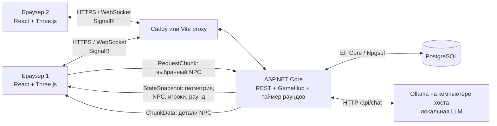
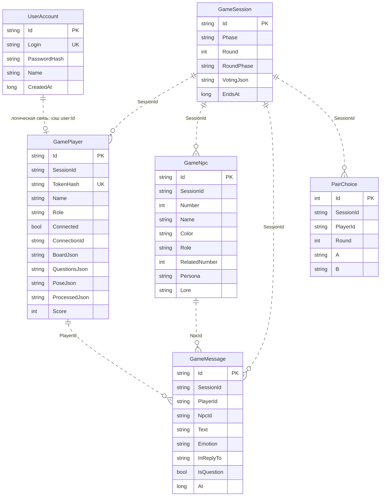

# Защита проекта «Угадай друзей»: презентация и техническая шпаргалка

**Актуально по коду репозитория на 31.10.2026.** Главная игровая сборка: `backend/Backend.csproj` и `frontend/`. Старые планы в `frontend/PLAN.md`, `backend/docs/roadmap.md` и часть текста `docs/integration.md` описывают прежний контракт; при расхождении ориентироваться на код. Ниже «реализовано» означает, что путь есть в коде, а не что он проверен на конкретном компьютере с Ollama и двумя браузерами.

## 1. Три слайда для презентации

### Слайд 1 — идея и ценность

**Название:** «Угадай друзей».

**Задача:** превратить проверку социальных связей и умение замечать противоречия в совместную игру. Среди десяти персонажей есть три настоящие пары друзей и четыре актёра, которые пытаются выдать себя за друзей других участников.

**Для кого:** для компании друзей, школьной/студенческой команды и игроков, которым нравятся социальная дедукция и совместное обсуждение.

**Польза:** игроки сравнивают истории, задают вопросы, ведут личные заметки, голосуют вместе и сразу видят результат. Локальная модель делает реплики персонажей зависящими от роли, биографии и контекста разговора. В одной комнате поддерживается до восьми живых игроков.

**Фраза на 20–30 секунд:** «Это браузерная 3D-игра социальной дедукции. Команда судей расследует, кто из десяти участников действительно дружит, а кто притворяется. Игроки свободно ходят по студии, общаются с персонажами и вместе выбирают пары. Ценность проекта — совместное расследование, в котором ответы персонажей связаны с их историями и предыдущими репликами».

### Слайд 2 — архитектура (рисунок-схема)

**Что сказать:** «Сервер хранит состояние и решает, какие действия допустимы; браузер строит сцену и интерфейс. Three.js работает в браузере, а не на сервере. WebSocket через SignalR доставляет позиции и события всем игрокам. PostgreSQL сохраняет аккаунты и состояние матча. Сервер сам обращается к локальной Ollama — браузеры к ней не подключаются. Базовая геометрия и метаданные мира приходят в снимке; детали конкретного NPC запрашиваются отдельно, когда он оказывается в центре обзора».

### Слайд 3 — технические особенности и оптимизация

| Тема | Что показать и сказать | Статус |
| --- | --- | --- |
| Авторизация | Регистрация/вход по логину и паролю → JWT → проверка при подключении к SignalR; код комнаты задаёт право ведущего или судьи. | Реализовано |
| Данные | PostgreSQL + Entity Framework Core; аккаунты, сессия, игроки, NPC и сообщения. Личная доска и голоса сериализованы в JSON-полях. | Реализовано |
| Кэш 10% | На HUD видны байты деталей NPC, `worldSizeBytes` и процент. Кэш хранит максимум одну запись и отклоняет запись сверх `0.1 × worldSizeBytes`. | Реализовано для **кэша деталей NPC**; общий лимит памяти/трафика **не реализован** |
| Локальный ИИ | Ollama, `/api/chat`, системный промпт с ролью и историей персонажа, ограниченный контекст прошлых реплик, JSON-ответ. | Интеграция реализована; реальную генерацию нужно показать при работающей Ollama |
| Оптимизация | Выбор NPC по фрустуму камеры, задержка 200 мс перед запросом, один активный chunk, не более 10 сетевых обновлений позы в секунду, сглаживание движения другого игрока, освобождение GPU-ресурсов. | Реализовано |
| Внешние модели и анимации | Персонажи собраны из геометрии Three.js; есть поворот головы, изменение позы сидя/стоя, подсветка реакции и облачко реплики. Импорт GLTF, скелетные анимации и потоковая загрузка 3D-моделей **не реализованы**. | Частично |

## 2. Сценарий демонстрации на 6 минут

**Перед выходом:** запустить Docker Compose и дождаться загрузки модели Ollama; проверить `/health`, `/health/db`, затем авторизованный `/health/ollama`. Подготовить два браузера с **разными аккаунтами** в одной комнате. Для допроса поставить короткий раунд через `GAME_ROUND_SECONDS`, например 15–20 секунд, и разумный `GAME_CHOICE_SECONDS`; выбор раунда на сервере идёт по таймеру, вручную перескочить к раунду 4 нельзя. Заранее проверить, что оба клиента открывают один и тот же хост. При недоступной модели сервер показывает ошибку генерации и не подставляет сценарную реплику.

| Время | Действие на экране | Короткая реплика |
| --- | --- | --- |
| 00:00–00:30 | Показать слайд 1 и лобби. | «Мы создали совместную игру, где судьи ищут настоящие пары среди актёров». |
| 00:30–02:00 | Войти, начать игру как ведущий; показать сцену, WASD/мышь, походить, сесть/встать у кресла, открыть доску и заметку. | «Сцена строится в Three.js по геометрии от сервера. Перемещение проверяется сервером; заметки сохраняются в БД». |
| 02:00–03:00 | Открыть второго игрока в другом браузере, показать его появление, переместить одного и наблюдать движение во втором. | «Каждый клиент отправляет позу не чаще десяти раз в секунду. Сервер проверяет её и рассылает `PlayersTick`; второй клиент сглаживает движение». |
| 03:00–04:00 | В 4-м раунде открыть «Задать вопрос», выбрать NPC и задать вопрос по его истории; показать ответ и связь с предыдущими репликами. | «У каждого персонажа есть роль, биография и общая история. В запрос к модели попадают его данные и ограниченная история сообщений». Если модель недоступна, показать ошибку и проверить Ollama. |
| 04:00–05:00 | Показать слайд 2 и HUD с кэшем; повернуть камеру на NPC и от него, показать изменение счётчика. | «REST нужен для входа, SignalR — для игры, PostgreSQL — для данных. Детали NPC загружаются по запросу; на HUD виден размер резидентного кэша относительно оценочного размера мира». |
| 05:00–06:00 | Ответы жюри; держать открытыми слайды 2–3. | Опорные ответы — раздел 7. |

**Риск тайминга:** при раундах по 120 секунд, нескольких голосованиях и генерации ИИ до допроса можно не успеть за минуту блока 03:00–04:00. Для живой защиты заранее провести матч до 4-го раунда либо сократить таймеры в конфигурации **до запуска** и отрепетировать. Голосование после раундов 2 и 4 может потребовать второго тура, если судьи выбрали разные пары.

## 3. Правила и источники правды

- Один матч сейчас привязан к сессии `main`; полноценные независимые комнаты с отдельными кодами и состояниями **не реализованы**. Код комнаты используется как допуск к общей комнате и роли.
- В матче 10 NPC: три пары друзей и четыре актёра. Состав создаётся из [`backend/Data/bots_database_v2.json`](../backend/Data/bots_database_v2.json), пары и места перемешиваются на сервере. Секретные роли, связи, персона и lore остаются на сервере до финала; клиент получает публичные метаданные.
- Раунды: 1 — визитки; 2 — истории; 3 — факты; 4 — допрос; 5 — перепалка. Голосование после **2, 4 и 5** раундов. В 4-м раунде каждому судье доступны два вопроса разным активным NPC, до 300 символов каждый.
- При несовпадении голосов проводится один второй тур среди предложенных пар. Победителя определяет большинство, при равенстве — случайный выбор. Выбранные два NPC удаляются из активного состава и очищаются из досок и чата.
- Очки общие для команды: настоящая пара +300/+200/+100 в раундах 2/4/5; друг и актёр −100; два актёра −150; два друга из разных пар — 0. Личные отметки актёров не дают очков.
- Ведущий запускает/сбрасывает матч; его наличие и переходы между раундами определяет сервер. Локальный таймер клиента только показывает оставшееся время.

## 4. Техническая архитектура

**Клиент.** React + TypeScript + Vite + Zustand обслуживают интерфейс и локальное представление состояния. Three.js строит WebGL-студию: пол, стены, два уровня трибуны, кресла и процедурных персонажей. Движение предсказывается локально для отзывчивости. Изменения доски, голосов и счёта применяются только после серверных событий. Источники: [`frontend/src/scene/Scene.tsx`](../frontend/src/scene/Scene.tsx), [`frontend/src/scene/setup.ts`](../frontend/src/scene/setup.ts), [`frontend/src/store/gameStore.ts`](../frontend/src/store/gameStore.ts).

**Сервер.** Активный ASP.NET Core сервис — [`backend/Program.cs`](../backend/Program.cs). REST: `/api/auth/register`, `/api/auth/login`, `/api/auth/me`, `/api/game-info`, `/api/host-info`, проверки `/health`, `/health/db`, `/health/ollama`. SignalR hub `/hubs/game` обрабатывает вход в комнату, движение, доску, вопросы, голосование и запрос деталей NPC. `RoundClock` раз в секунду проверяет сроки фаз; `RoundDirector` создаёт реплики NPC. `GameGate` сериализует изменения общего матча, `LlmLock` ограничивает одновременную генерацию. Каталог `backend/TalkToEveryone.Api/` содержит отдельный прототип и **не входит в сборку `Backend.csproj`**.

**Сеть.** SignalR использует WebSocket. После подключения клиент вызывает `Auth` с кодом комнаты; сервер отвечает `AuthOk`, затем полным `StateSnapshot`. Лишь после снимка доступны игровые команды. При переподключении клиент повторяет `Auth`, получает новый снимок и заменяет локальное состояние. `SendPose` несёт возрастающий `seq`; у команд доски, голосования и вопросов есть `requestId`, который сервер использует для защиты от повторной обработки. Примеры событий: `PlayersTick`, `NpcSay`, `BoardSnapshot`, `VotingState`, `NpcsRemoved`, `ActionReject`.

**Деплой.** [`docker-compose.yml`](../docker-compose.yml) поднимает PostgreSQL 16, backend на .NET 10, Vite frontend, Caddy и Ollama; модель скачивается перед запуском API. Caddy обслуживает собранный фронтенд по HTTPS и проксирует `/api/*` и `/hubs/*`; Vite использует прокси при разработке. Для показа в локальной сети предусмотрены Radmin VPN/Hamachi и `start-host.bat`. HTTPS с локальным сертификатом и LAN-доступ надо отдельно проверить на устройствах перед защитой.

### Поток данных и загрузка игровых объектов

1. `GET /api/game-info` даёт публичные правила до входа. После входа `StateSnapshot` содержит геометрию комнаты, список NPC, позиции игроков, раунд, доску, чат и `worldSizeBytes`.
2. Браузер создаёт меши комнаты и NPC из Three.js-примитивов. Файлы 3D-моделей по сети сейчас не загружаются.
3. Каждый кадр `NpcLod` ищет NPC в поле зрения, наиболее близкого к центру камеры. После устойчивого выбора в течение 200 мс посылается `RequestChunk {reqId, ids:[id]}`.
4. Сервер возвращает `ChunkData` с публичными деталями одного NPC — отображаемым именем, цветом и подсказкой голоса. Клиент принимает только ответ на актуальный `reqId`, проверяет байтовый лимит и показывает имя. При смене цели удаляет запись и посылает `ReleaseChunk`.
5. `ReleaseChunk` сейчас не освобождает отдельный серверный ресурс: локальный кэш очищается клиентом. Это полезно проговорить, если спросят про «потоковую загрузку»: реализована **подгрузка метаданных NPC по запросу**, потоковая доставка геометрии/текстур **не реализована**.

## 5. База данных: схема, связи, хранение

PostgreSQL подключён через EF Core/Npgsql. Миграции применяются при старте. Таблицы и уникальные индексы определены в [`backend/Persistence/GameDb.cs`](../backend/Persistence/GameDb.cs), поля — в [`backend/Domain/Models.cs`](../backend/Domain/Models.cs). В EF-модели **нет явно заданных внешних ключей и навигационных свойств**: перечисленные ниже связи логические, по значениям ID; их целостность обеспечивает код, а не ограничения FK.

| Сущность | Что означает на практике |
| --- | --- |
| `UserAccount` | Постоянный аккаунт: логин, имя, соль и хэш пароля в `PasswordHash`, дата создания. Логин уникален. |
| `GameSession` | Текущая фаза/раунд и дедлайн в Unix milliseconds. `VotingJson` хранит тур, электорат, бюллетени, выбывших NPC и общий счёт. Сейчас одна запись `main`. |
| `GamePlayer` | Участник комнаты. `TokenHash` фактически равен SHA-256 от строки `user:<account.Id>` и обеспечивает повторный вход того же аккаунта. `BoardJson` — личные пары/метки/заметки; `QuestionsJson` — лимит и адресаты; `PoseJson` — положение; `ProcessedJson` — обработанные ID команд. Пара `(SessionId, Name)` уникальна. |
| `GameNpc` | Роль `friend`/`actor`, номер места, публичный цвет и секретные `Persona`, `Lore`, `RelatedNumber`. Пара `(SessionId, Number)` уникальна. |
| `GameMessage` | Вопросы и ответы/реплики с временем и связью `InReplyTo`; индекс `(SessionId, At)` помогает хронологической выдаче. |
| `PairChoice` | Таблица прежнего индивидуального выбора; в текущем командном голосовании используется `GameSession.VotingJson`. Не представлять `PairChoice` как основное место хранения актуальных голосов. |

**Важные нюансы:** роль и история NPC не передаются в обычном `StateSnapshot`. После исключения NPC его запись в таблице остаётся, а ID уходит в список `Eliminated`; сообщения исключённых персонажей удаляются. При старте новой игры состав NPC создаётся заново, сообщения и выборы очищаются. После перезапуска backend сохранённые игроки помечаются отключёнными, а висящие вопросы приводятся в согласованное состояние. JSON-поля удобны для прототипа, но затрудняют SQL-поиск по отдельным заметкам и требуют осторожной работы при расширении до многих комнат.

## 6. Авторизация, ИИ, кэш и оптимизация подробно

### Авторизация и ограничения безопасности

1. `register` проверяет логин 3–32 символа, пароль 4–128, имя 1–32; `login` сверяет пароль с PBKDF2-HMAC-SHA256 (100 000 итераций, случайная соль 16 байт, постоянное время сравнения).
2. Backend выдаёт подписанный HS256 JWT на 7 дней. REST `/api/auth/me` и WebSocket hub проверяют JWT; для WebSocket SignalR передаёт токен в параметре `access_token` URL, что поддержано обработчиком JWT в `Program.cs`.
3. Внутри hub метод `Auth` дополнительно проверяет код комнаты (`GAME_HOST_CODE` для ведущего, `GAME_ROOM_CODE` для судьи) и связывает соединение с аккаунтом. Клиент хранит JWT в `localStorage`, чтобы переживать обновление страницы.
4. **Для публичного развёртывания не готово:** в compose есть значения секретов/пароля по умолчанию, сервер допускает любой CORS origin, пароль можно задать длиной 4 символа, JWT лежит в `localStorage`, код ведущего сообщается через `/api/host-info`. Для защиты это честно описывать как прототип для локальной сети; перед публичным запуском нужны отдельное усиление настроек и проверка модели угроз.

### Локальный ИИ и «память»

- Основной путь: backend проверяет Ollama через `/api/tags`, находит настроенную модель и вызывает `/api/chat` с `stream:false`, `keep_alive:-1`, JSON-схемой `{text, emotion}` и параметрами генерации. Значения по умолчанию в коде: `qwen2.5:3b-instruct`, `temperature:0.75`, `num_ctx:4096`, `num_predict:150`; таймаут настраивается.
- У персонажа есть роль, связанный номер, persona и lore из БД. Системный промпт строится отдельно для друга и актёра. Для вопроса из 4-го раунда передаются последние **до восьми** сообщений этого NPC, для раундовых реплик — последние **до 16** сообщений комнаты. Это контекст текущей игры, а не долговременная память между матчами или отдельное обучение модели.
- Если Ollama недоступна, код может использовать настроенный OpenAI-совместимый `LLM_ENDPOINT` с API-ключом. Если и он недоступен, сервер сообщает об ошибке генерации без шаблонной реплики. Для проверки локальной модели показать `/health/ollama` с `connected:true` и ответ, связанный с конкретным вопросом/предыдущей историей.
- Не реализованы: распознавание/синтез речи, голосовой чат, долговременная память ИИ, полноценная схема «режиссёра реакций» и цепной выбор следующего говорящего из старой спецификации.

### Кэш и проверка 10%

`worldSizeBytes` сервер вычисляет как сумму UTF-8 размеров JSON геометрии сцены, публичных метаданных NPC и их небольших деталей. В клиентском `NpcCache` размер записи берётся как максимум из `sizeBytes` сервера и фактического UTF-8 размера JSON деталей. Условие допуска: `bytes + newBytes ≤ 0.1 × worldSizeBytes` после удаления старой записи; размер кэша — максимум **один NPC**. При неизвестном размере мира запись не принимается. На HUD отображаются число записей, байты, размер мира и `(bytes / worldSizeBytes) × 100%`; консоль пишет `[cache/world]`.

**Как подтвердить на защите:** открыть HUD и DevTools, навести камеру на NPC, дождаться `ChunkData`, показать формулу по реальным числам, отвернуть камеру и показать `0 B` после `ReleaseChunk`. Повернуть обратно: должен прийти новый запрос. Если `worldSizeBytes = 0` или размер детали превышает 10%, клиент показывает предупреждение и не сохраняет запись. **Предел утверждения:** измеряется только кэш деталей NPC; базовая сцена, React state, GPU-буферы, JS heap, браузерный HTTP-кэш и сетевой трафик в эти 10% не входят. Автоматический отчёт о потреблении всей памяти **не реализован**.

### Алгоритмы оптимизации и ограничения

| Механизм | Реализация | Что даёт / предел |
| --- | --- | --- |
| Выбор деталей по видимости | `THREE.Frustum`, проекция позиции NPC к центру экрана, debounce 200 мс | Не запрашивать детали всех десяти сразу; это выбор **одной записи**, не переключение уровня детализации геометрии. |
| Лимит кэша | LRU-контейнер `Map`, максимум одна запись и 10% оценочного размера мира | Контролирует резидентные детали NPC; при смене цели запись удаляется. |
| Сеть движения | Не чаще 10 Гц, только при изменении позы, возрастающий `seq`; на сервере проверка скорости, границ и высоты | Меньше сообщений и простая защита от недопустимого движения. Точная проверка коллизий мебели на сервере **не реализована**; клиент проверяет стены, платформы и препятствия локально. |
| Интерполяция | Другие игроки плавно двигаются к последней серверной позиции; крупный скачок переносится сразу | Скрывает дискретность `PlayersTick`. |
| Рендер | Процедурные меши без тяжёлых загружаемых текстур, туман, свет без дорогих динамических теней; освобождение геометрий/текстур при удалении сцены | Снижает стоимость загрузки и утечки GPU-ресурсов; измеримые FPS/draw calls/triangles доступны в HUD. Числовой прирост производительности и замеры на разных устройствах **не подтверждены**. |

## 7. Короткие ответы на вопросы жюри

| Вопрос | Ответ |
| --- | --- |
| Почему нужен сервер, если 3D уже в браузере? | Сервер единообразно проверяет вход, позицию, голосование, раунды, ответы NPC и счёт; иначе клиенты могли бы расходиться по состоянию. |
| Что происходит при потере связи? | SignalR переподключается, клиент повторяет `Auth`, получает новый `StateSnapshot` и восстанавливает положение, доску, чат, раунд и голосование. Временный кэш деталей очищается. |
| Где секретные роли NPC? | В `GameNpc` в PostgreSQL и в промпте на сервере. До финала клиент получает только публичные поля. |
| Как NPC помнит сказанное? | Сервер хранит сообщения в `GameMessage` и добавляет ограниченный фрагмент истории в следующий запрос к модели. Между новыми матчами память не сохраняется. |
| Что именно ограничено десятью процентами? | Только локальный кэш деталей NPC относительно оценочного `worldSizeBytes` из сервера. Это не утверждение про всю память браузера. |
| Как докажете многопользовательский режим? | Два разных аккаунта в двух браузерах: второй появляется в `PlayersTick`, его движение и занятие кресла видно на первом; голосование и счёт общие. |
| Что ещё не реализовано? | Независимые комнаты, потоковая загрузка GLTF-моделей, скелетная анимация, голосовой чат, долговременная память ИИ, строгий лимит всей памяти браузера и полноценная серверная проверка столкновений с мебелью. |

## 8. Где искать реализацию

- Сборка и запуск: [`README.md`](../README.md), [`backend/README.md`](../backend/README.md), [`docker-compose.yml`](../docker-compose.yml).
- REST и JWT: [`backend/Program.cs`](../backend/Program.cs), [`backend/Services/AuthService.cs`](../backend/Services/AuthService.cs), [`frontend/src/store/authStore.ts`](../frontend/src/store/authStore.ts).
- БД: [`backend/Persistence/GameDb.cs`](../backend/Persistence/GameDb.cs), [`backend/Domain/Models.cs`](../backend/Domain/Models.cs), [`backend/Domain/VotingData.cs`](../backend/Domain/VotingData.cs).
- Сетевые события и правила: [`backend/Realtime/GameHub.cs`](../backend/Realtime/GameHub.cs), [`backend/Services/GameState.cs`](../backend/Services/GameState.cs), [`backend/Services/Voting.cs`](../backend/Services/Voting.cs), [`frontend/src/core/signalr.ts`](../frontend/src/core/signalr.ts).
- 3D и кэш: [`frontend/src/scene/Scene.tsx`](../frontend/src/scene/Scene.tsx), [`frontend/src/scene/Npc.ts`](../frontend/src/scene/Npc.ts), [`frontend/src/scene/lod.ts`](../frontend/src/scene/lod.ts), [`frontend/src/core/cache.ts`](../frontend/src/core/cache.ts).
- ИИ: [`backend/Services/LlmClient.cs`](../backend/Services/LlmClient.cs), [`backend/Services/NpcDatabase.cs`](../backend/Services/NpcDatabase.cs), [`backend/Services/RoundClock.cs`](../backend/Services/RoundClock.cs).
